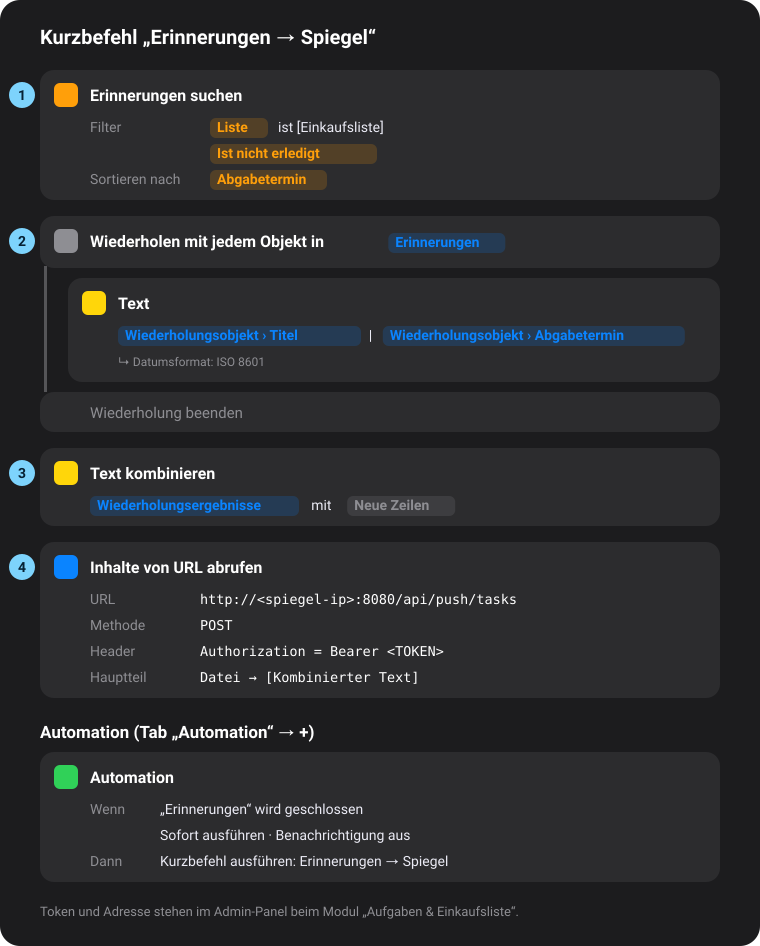

# Apple Erinnerungen auf dem Spiegel

Apple bietet keine Schnittstelle für Erinnerungen. Deshalb schickt ein **Kurzbefehl** auf iPhone, iPad oder Mac die offenen Erinnerungen an den Spiegel. Das Modul *Aufgaben & Einkaufsliste* zeigt dann den zuletzt empfangenen Stand.

[English guide](apple-reminders.md)

## 1. Modul einrichten

1. Admin-Panel → *Module* → *Aufgaben & Einkaufsliste* anlegen (oder öffnen).
2. **Quelle:** *Apple Erinnerungen (Kurzbefehle)*.
3. Speichern. Darunter zeigt das Modul **Adresse** und **Header-Wert** (mit Token) zum Kopieren – genau das trägst du gleich in Block 4 ein.

## 2. Kurzbefehl bauen

In der App **Kurzbefehle** → **+** (neuer Kurzbefehl) und diese vier Aktionen in dieser Reihenfolge hinzufügen. So sieht das Ergebnis aus:

<p align="center"></p>

| # | Aktion (Suche in der Aktionsliste) | Was du einstellst |
|---|---|---|
| 1 | **Erinnerungen suchen** | *Filter hinzufügen* → **Ist erledigt** – *ist nicht*. Optional zweiter Filter **Liste** – *ist* – deine Liste (z. B. „Einkauf“). *Sortieren nach* **Fälligkeitsdatum**. |
| 2 | **Wiederholen mit jedem Objekt** | Eingabe: *Erinnerungen* (wird automatisch gesetzt). Darin eine Aktion **Text** einfügen und hineintippen: Variable *Wiederholungsobjekt* → **Titel**, dann ` \| `, dann *Wiederholungsobjekt* → **Fälligkeitsdatum**. Die Datums-Variable antippen → **Datumsformat: ISO 8601**. |
| 3 | **Text kombinieren** | Eingabe: *Wiederholungsergebnisse*, Trennzeichen: **Neue Zeilen**. |
| 4 | **Inhalte von URL abrufen** | URL: die **Adresse** aus dem Modul. *Mehr anzeigen* → Methode **POST** → *Header hinzufügen*: Schlüssel `Authorization`, Wert: der **Header-Wert** aus dem Modul (`Bearer …`). *Hauptteil der Anfrage*: **Datei** → Variable *Kombinierter Text*. |

Einmal mit ▶ testen: Als Ergebnis erscheint `{"ok":true,"received":…}`, und das Modul auf dem Spiegel zeigt sofort deine Liste.

> **Nur Titel reichen dir?** Dann lass Block 2 weg und nimm in Block 3 direkt die gefundenen *Erinnerungen* als Eingabe.

## 3. Automatisch senden (Automation)

Kurzbefehle → Tab **Automation** → **+** (bzw. *Neue Automation*):

1. **App** wählen → *Erinnerungen* → **Wird geschlossen** → *Weiter*.
2. **Sofort ausführen** wählen, *Bei Ausführung benachrichtigen* ausschalten.
3. Als Aktion deinen Kurzbefehl („Erinnerungen → Spiegel“) wählen → *Fertig*.

Optional eine zweite Automation **Tageszeit** (z. B. täglich 6:00) mit denselben Einstellungen, damit der Spiegel morgens aktuell ist.

## Gut zu wissen

- Das Handy muss den Spiegel erreichen – im Heim-WLAN klappt das direkt, unterwegs nur per VPN oder Reverse-Proxy mit `https://`.
- Die Adresse muss die **IP oder der Name des Spiegels** sein (z. B. `http://192.168.1.50:8080/…` oder `http://mirror.local:8080/…`), nicht `localhost`.
- Der Spiegel behält die zuletzt empfangene Liste, auch über Neustarts. Kommt länger als eingestellt nichts Neues, zeigt das Modul klein „Stand: …“.
- Was der Spiegel versteht: Zeilen `Titel | Fällig | Priorität` (Fälligkeit `2026-10-28` oder ISO 8601 mit Uhrzeit, Priorität Hoch/Mittel/Niedrig oder 1–9) oder JSON (`["Milch", …]`, `{"items":[{"title":…,"due":…}]}`).
- Test vom Rechner aus:
  ```bash
  curl -X POST -H "Authorization: Bearer TOKEN" --data-binary $'Milch\nBrot | 2026-10-28' http://SPIEGEL:8080/api/push/tasks
  ```
- Ein neuer Token im Admin-Panel sperrt alte Kurzbefehle aus.
