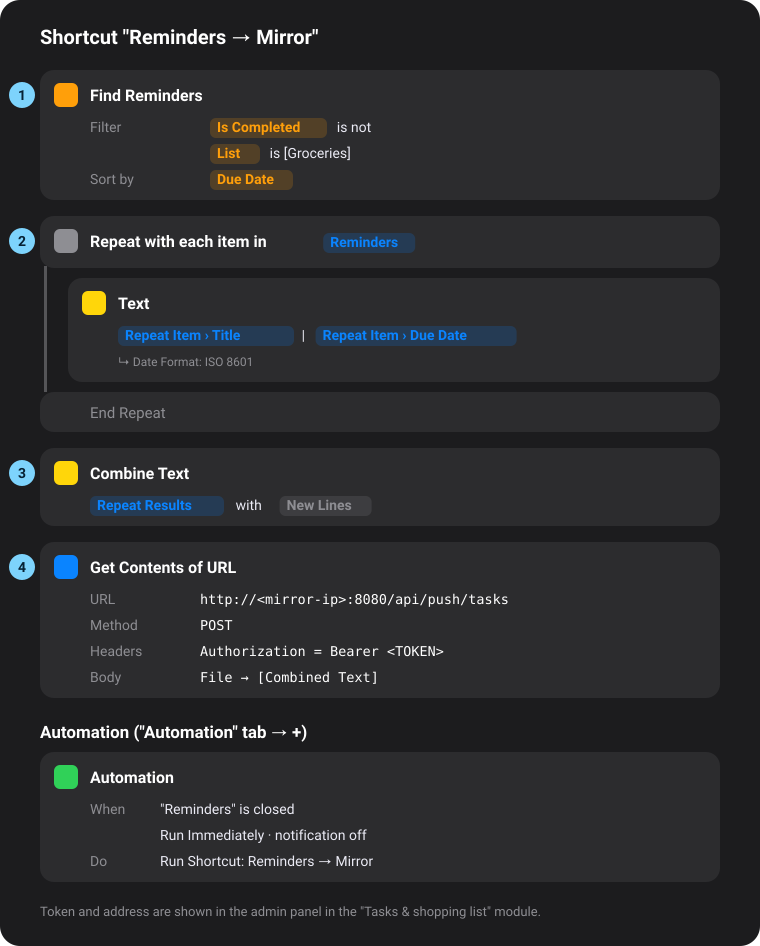

# Apple Reminders on the mirror

Apple offers no Reminders API. Instead, a **Shortcut** on your iPhone, iPad or Mac sends the open reminders to the mirror. The *Tasks & shopping list* module then shows the last state it received.

[Deutsche Anleitung](apple-reminders.de.md)

## 1. Set up the module

1. Admin panel → *Modules* → add (or open) *Tasks & shopping list*.
2. **Source:** *Apple Reminders (Shortcuts)*.
3. Save. Below, the module shows the **address** and the **header value** (with the token) to copy – that's what goes into block 4.

## 2. Build the shortcut

In the **Shortcuts** app → **+** (new shortcut), add these four actions in this order. The result looks like this:

<p align="center"></p>

| # | Action (search the action list) | What to set |
|---|---|---|
| 1 | **Find Reminders** | *Add Filter* → **Is Completed** – *is not*. Optionally a second filter **List** – *is* – your list (e.g. "Groceries"). *Sort by* **Due Date**. |
| 2 | **Repeat with Each** | Input: *Reminders* (set automatically). Inside, add a **Text** action and type: variable *Repeat Item* → **Title**, then ` \| `, then *Repeat Item* → **Due Date**. Tap the date variable → **Date Format: ISO 8601**. ⚠️ Don't use the variable *Reminders* – it holds the whole list, and every reminder would arrive several times. |
| 3 | **Combine Text** | Input: *Repeat Results*, separator: **New Lines**. |
| 4 | **Get Contents of URL** | URL: the **address** from the module. *Show More* → Method **POST** → *Add new header*: key `Authorization`, value: the **header value** from the module (`Bearer …`). *Request Body*: **File** → variable *Combined Text*. |

Test once with ▶: the result is `{"ok":true,"received":…}` and the module on the mirror shows your list immediately.

> **Titles are enough?** Skip block 2 and use the found *Reminders* directly as the input of block 3.

## 3. Send automatically (automation)

Shortcuts → **Automation** tab → **+** (*New Automation*):

1. Choose **App** → *Reminders* → **Is Closed** → *Next*.
2. Choose **Run Immediately**, turn off *Notify When Run*.
3. Pick your shortcut ("Reminders → Mirror") as the action → *Done*.

Optionally a second automation **Time of Day** (e.g. daily 6:00) with the same settings, so the mirror is up to date in the morning.

## Good to know

- The phone has to reach the mirror – in your home Wi-Fi that just works; from outside only via VPN or a reverse proxy with `https://`.
- The address must be the mirror's **IP or name** (e.g. `http://192.168.1.50:8080/…` or `http://mirror.local:8080/…`), not `localhost`.
- The mirror keeps the last list it received, also across restarts. If no update arrives for longer than configured, the module shows a small "Last update" note.
- Accepted formats: lines `title | due | priority` (due `2026-10-28` or ISO 8601 with time, priority High/Medium/Low or 1–9) or JSON (`["Milk", …]`, `{"items":[{"title":…,"due":…}]}`).
- Test from a computer:
  ```bash
  curl -X POST -H "Authorization: Bearer TOKEN" --data-binary $'Milk\nBread | 2026-10-28' http://MIRROR:8080/api/push/tasks
  ```
- Creating a new token in the admin panel locks out old shortcuts.
